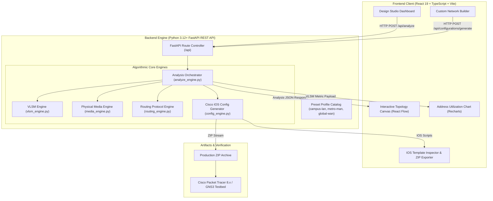
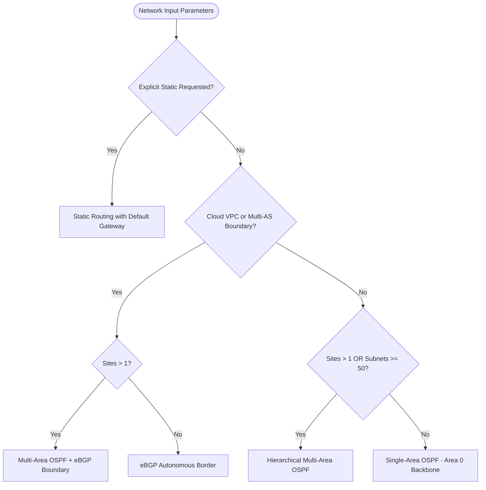

# NetArchitect: Intelligent Network Recommendation & Configuration Engine

**Name**: Tanmay Aggarwal  
**Enrollment No**: 00714802724  
**Course**: CIC-307 Computer Networks  
**Academic Term**: 2026–2027  

---

[](https://www.python.org/)
[](https://fastapi.tiangolo.com/)
[](https://react.dev/)
[](https://vitejs.dev/)
[](https://tailwindcss.com/)
[](https://www.cisco.com/)
[]()
[](https://www.docker.com/)

---

## Table of Contents

1. [Executive Summary](#executive-summary)
2. [Key Capabilities & Features](#key-capabilities--features)
3. [System Architecture & Data Flow](#system-architecture--data-flow)
4. [Algorithmic Decision Engines](#algorithmic-decision-engines)
   - [1. Mathematical VLSM Address Allocator](#1-mathematical-vlsm-address-allocator)
   - [2. Physical Media & Transceiver Selection Engine](#2-physical-media--transceiver-selection-engine)
   - [3. Dynamic Routing Protocol Decision Engine](#3-dynamic-routing-protocol-decision-engine)
   - [4. Cisco IOS Configuration Synthesis Engine](#4-cisco-ios-configuration-synthesis-engine)
5. [Preset Network Architectures](#preset-network-architectures)
6. [Interactive User Interface](#interactive-user-interface)
7. [REST API Documentation](#rest-api-documentation)
8. [Installation & Quick Start](#installation--quick-start)
   - [Option A: Local Development Setup](#option-a-local-development-setup)
   - [Option B: Containerized Deployment via Docker](#option-b-containerized-deployment-via-docker)
9. [Automated Testing & Quality Assurance](#automated-testing--quality-assurance)
10. [Hardware Simulation & Packet Tracer Verification](#hardware-simulation--packet-tracer-verification)
11. [Repository Structure](#repository-structure)
12. [Viva Voce & Technical Defense Preparation](#viva-voce--technical-defense-preparation)
13. [Security, Production & Design Disclaimers](#security-production--design-disclaimers)

---

## Executive Summary

**NetArchitect** is a computer network engineering platform developed for the **CIC-307 Computer Networks** curriculum. The software automates the complete lifecycle of enterprise network design:
1. **Validates** complex hierarchical topology parameters (user demands, distances, bandwidth, redundancy, cloud borders, and ACL security policies).
2. **Computes** mathematically optimal, non-overlapping IPv4 Variable Length Subnet Masking (VLSM) allocations with automatic gateway and broadcast provisioning.
3. **Recommends** standardized physical transmission media and optical transceivers based on deterministic IEEE 802.3 physical layer boundaries.
4. **Selects** optimal interior and exterior routing architectures (Single-Area OSPF, Multi-Area OSPF, or eBGP) according to autonomous system and domain scale.
5. **Synthesizes** production-hardened, multi-tier Cisco IOS configuration templates for Layer 3 distribution switches, Layer 2 access switches, and edge WAN routers.
6. **Visualizes** interactive topology graphs with real-time capacity analytics using React Flow and Recharts.

---

## Key Capabilities & Features

- **Mathematical IPv4 Subnet Allocation (RFC 4632 / RFC 3021)**:
  - Deterministic descending-sort allocation algorithm that guarantees minimum address waste and prevents internal address fragmentation.
  - Automatic boundary alignment using integer bitwise arithmetic.
  - Zero subnet overlap guarantee with exhaustive range validation.
  - Special RFC 3021 (`/31` point-to-point) and RFC 4632 (`/32` loopback) subnet support.
  - Prefix aggregation and route summarization computation.

- **Deterministic Physical Layer Planning (IEEE 802.3 standards)**:
  - Strict distance thresholds: Cat6a (10GBASE-T) $\le 100\text{ m}$, OM4 Multi-Mode Fiber (10GBASE-SR) $\le 400\text{ m}$, OS2 Single-Mode Fiber (10GBASE-LR) $\le 10\text{ km}$, and OS2 (10GBASE-ER) $\le 40\text{ km}$.
  - Hard physical validation: raises `PhysicalDistanceViolationError` when copper or multimode limits are violated.
  - Long-distance carrier transit handoff modeling for wide-area connections exceeding 40 km.

- **Scope-Driven Routing Topology Design**:
  - Automatically recommends **Single-Area OSPF (Area 0)**, **Hierarchical Multi-Area OSPF**, or **Multi-Area OSPF + eBGP** based on site count, subnet density, and cloud border requirements.
  - Configures OSPF Router IDs, passive interface defaults, and wildcard mask network statements.
  - Synthesizes BGP Autonomous System boundaries and route aggregation commands.

- **Security-First Cisco IOS Configuration Generation**:
  - **Native VLAN Blackholing**: Dynamically discovers unused VLAN IDs (e.g., VLAN 4094) to assign as isolated native VLANs on 802.1Q trunks, mitigating VLAN hopping attacks.
  - **Trunk Restriction**: Enforces `switchport trunk allowed vlan` whitelist filtering across all switch uplinks.
  - **Layer 2 Edge Hardening**: Provisions Rapid Spanning Tree Protocol (Rapid-PVST+), PortFast, and BPDU Guard on all endpoint access interfaces.
  - **Access Control Lists (ACLs)**: Synthesizes direction-specific extended IPv4 ACLs with automatic IoT containment rules (restricting IoT segments from accessing core RFC 1918 subnets while permitting controlled egress).
  - **Management Hardening**: Prohibits unencrypted Telnet (`transport input ssh`), enforces RSA 2048-bit crypto key generation, and disables DNS lookup.

- **Modern Interactive Dashboard**:
  - Real-time React Flow topology canvas with pan, zoom, custom node icons, and SVG export.
  - Real-time address pool utilization chart powered by Recharts.
  - Dynamic Custom Network Builder allowing runtime editing of VLANs, links, security ACLs, redundancy, cloud, and QoS options.
  - One-click ZIP export generating separate `.txt` configuration files for each network tier.

---

## System Architecture & Data Flow

NetArchitect adopts a decoupled client-server architecture separating core networking logic from user presentation:



---

## Algorithmic Decision Engines

### 1. Mathematical VLSM Address Allocator

Given a root IPv4 CIDR block (e.g. `10.10.0.0/16`) and an array of $M$ VLAN requests with host requirements $H = [h_1, h_2, \dots, h_M]$:

1. **Host Demand Calculation**:
   For each subnet, the total address demand $D$ accounts for the requested client endpoints, 1 Layer 3 default gateway, and standard IPv4 network/broadcast overhead:
   $$D = h_i + 1 + 2$$
   The required prefix length $P$ is determined via:
   $$b = \lceil \log_2(D) \rceil = (D - 1).\text{bit\_length}()$$
   $$P = 32 - b$$

2. **Descending-Sort Greedy Allocation**:
   Subnet requests are sorted in descending order of block size ($P$ ascending). This mathematical ordering prevents external fragmentation of contiguous binary space:
   $$P_{\text{alloc\_0}} \le P_{\text{alloc\_1}} \le \dots \le P_{\text{alloc\_M}}$$

3. **Binary Boundary Alignment**:
   Each allocation offset is aligned to integer multiples of $2^{32 - P}$. The allocator evaluates every block against assigned and reserved ranges to guarantee:
   $$\text{Subnet}_i \cap \text{Subnet}_j = \emptyset \quad \forall i \ne j$$

4. **Special Prefix Semantics**:
   - `/31` point-to-point links (RFC 3021): 2 total addresses, 2 usable addresses, no dedicated broadcast.
   - `/32` loopback interfaces: 1 total address, 1 usable address.

---

### 2. Physical Media & Transceiver Selection Engine

The physical media engine enforces strict deterministic IEEE 802.3 Ethernet PHY boundaries based on measured link distances $d$ (in meters) and bandwidth requirements:

| Distance Range ($d$) | Media Classification | Transceiver Model | Nominal Wavelength | Applicable IEEE Standard | Engineering Constraints |
|:---|:---|:---|:---|:---|:---|
| $0 \text{ m} \le d \le 100 \text{ m}$ | **Cat6a Copper UTP** | 10GBASE-T | Electrical | IEEE 802.3an | Strict 100 m channel limit; susceptible to alien crosstalk if unshielded. |
| $100 \text{ m} < d \le 400 \text{ m}$ | **OM4 Multimode Fiber (MMF)** | 10GBASE-SR | 850 nm | IEEE 802.3ae | Modal dispersion limit. Requires 50/125 $\mu\text{m}$ laser-optimized fiber. |
| $400 \text{ m} < d \le 10,000 \text{ m}$ | **OS2 Single-Mode Fiber (SMF)** | 10GBASE-LR | 1310 nm | IEEE 802.3ae | Zero dispersion wavelength window; requires optical attenuation verification. |
| $10,000 \text{ m} < d \le 40,000 \text{ m}$ | **OS2 Single-Mode Fiber (SMF)** | 10GBASE-ER | 1550 nm | IEEE 802.3ae | Low attenuation window; requires minimum receiver optical power validation. |
| $d > 40,000 \text{ m}$ | **Carrier Engineered Transport** | Carrier Handoff | Engineered | ITU-T / Carrier | Exceeds single-optic direct reach; requires optical amplification / DWDM. |

> **Violation Handling**: If an operator requests Copper (`cat6a`, `copper`) for a link $> 100\text{ m}$, the engine raises a `PhysicalDistanceViolationError` with a recommended fiber alternative, preventing invalid network deployments.

---

### 3. Dynamic Routing Protocol Decision Engine

Routing protocol selection is evaluated through a deterministic decision matrix assessing routing boundaries, autonomous system borders, site count, and subnet scale:



- **Single-Area OSPF (Area 0)**: Chosen for single-site topologies with $<50$ subnets. Provides rapid link-state Shortest Path First (Dijkstra SPF) convergence without area transition complexity.
- **Hierarchical Multi-Area OSPF**: Deployed when sites $> 1$ or subnets $\ge 50$. Localizes Link-State Advertisements (LSAs) within stub/standard areas and reduces routing table memory through Area Border Router (ABR) route summarization.
- **eBGP Boundary Peering**: Configured when cloud connectivity (AWS Direct Connect / Azure ExpressRoute) or multi-AS peering is enabled.

---

### 4. Cisco IOS Configuration Synthesis Engine

The configuration engine converts the analytical model into ready-to-run Cisco IOS CLI scripts:

#### A. Layer 3 Distribution Switch (`*-DIST-01`)
- **IP Routing & SVIs**: Generates `interface Vlan<ID>` configurations with computed gateway IPs and subnet masks for all allocated segments.
- **Dynamic Routing**:
  ```cisco
  router ospf 10
   router-id 10.255.255.1
   network 10.10.0.0 0.0.255.255 area 0
   passive-interface default
  ```
- **Security & IoT Isolation ACLs**:
  ```cisco
  ip access-list extended NETARCH-VLAN-50-IN
   deny ip any 10.10.0.0 0.0.255.255
   permit ip any any
  interface Vlan50
   ip access-group NETARCH-VLAN-50-IN in
  ```
- **802.1Q Hardened Trunk Uplink**:
  ```cisco
  interface GigabitEthernet1/0/48
   description Uplink trunk - restricted allowed VLANs
   switchport mode trunk
   switchport trunk native vlan 4094
   switchport trunk allowed vlan 10,20,30,40,50
   switchport nonegotiate
   no shutdown
  ```

#### B. Layer 2 Access Switch (`*-ACCESS-01`)
- **Spanning Tree Hardening**:
  ```cisco
  spanning-tree mode rapid-pvst
  spanning-tree bpduguard default
  interface range GigabitEthernet1/0/1-47
   switchport mode access
   switchport access vlan 10
   spanning-tree portfast
   spanning-tree bpduguard enable
   shutdown
  ```
- **Native VLAN Blackhole**: Creates isolated `vlan 4094` named `NATIVE-BLACKHOLE` to prevent double-tagging VLAN hopping exploits.

#### C. Edge WAN Router (`*-EDGE-01`)
- **QoS Real-Time Traffic Prioritization**:
  ```cisco
  class-map match-any NETARCH-REALTIME
   match dscp ef
  policy-map NETARCH-WAN-OUT
   class NETARCH-REALTIME
    priority percent 20
   class class-default
    fair-queue
  ```
- **IKEv2 Site-to-Site VPN Proposals**:
  ```cisco
  crypto ikev2 proposal NETARCH-IKEV2
   encryption aes-cbc-256
   integrity sha256
   group 14
  ```

---

## Preset Network Architectures

NetArchitect comes preloaded with three production-grade reference scenarios:

| Architecture Preset | Network Scope | Endpoint Scale | Key Technologies | Primary Media & Links |
|:---|:---|:---|:---|:---|
| **Enterprise Campus LAN** | 3 Campus Buildings | 1,600 Endpoints | PoE Access, 802.1Q, Rapid-PVST+, OSPF Area 0, IoT Quarantine | Cat6a (80 m), OM4 MMF (250 m, 380 m) |
| **Metropolitan Area Network (MAN)** | 3 Metro Sites (HQ, FinTech A, FinTech B) | 450 Financial Users | EVPL QinQ, Multi-Area OSPF, Strict DSCP EF QoS, Sub-5ms Latency Target | OS2 SMF (4.5 km, 12 km 10GBASE-LR/ER) |
| **Global Enterprise WAN** | 4 Global Cities + 1 Cloud VPC | 2,000 Devices | Full-Mesh IPsec VPN, AES-256 IKEv2, eBGP Peering, OSPF Interior | Global Carrier Engineered Optical Transport (>40 km) |

---

## Interactive User Interface

The frontend dashboard provides a comprehensive suite of network engineering tools:

| UI Workspace Tab | Functionality |
|:---|:---|
| **Overview** | High-level summary metrics (sites, endpoints, VLAN count, allocated subnets), key architectural decisions, and address utilization chart. |
| **Scenarios** | One-click selector for the 3 verified reference architectures (Campus LAN, Metro MAN, Global WAN). |
| **Architecture** | Full-screen interactive React Flow topology canvas with pan, zoom, dynamic node status indicators, and SVG export. |
| **VLSM Planner** | Comprehensive tabular IPv4 address plan displaying VLAN IDs, CIDR notation, subnet masks, wildcard masks, default gateways, and usable ranges. |
| **Routing & Media** | In-depth technical breakdown of recommended routing protocols, transceiver reaches, and route summarization candidates. |
| **Configurations** | Split-pane Cisco IOS script inspector for Distribution Switch, Access Switch, and WAN Edge Router with one-click individual download and complete ZIP bundle export. |
| **Custom Network Builder**| Dynamic interactive form allowing full customization of VLAN host demands, link distances, security ACL rules, QoS, PoE, and cloud boundaries. |
| **AI Audit Log** | Formal engineering audit document detailing generative AI defects, mathematical root cause analyses, and RFC-compliant fixes. |

---

## REST API Documentation

The backend exposes a REST API with interactive Swagger OpenAPI documentation available at `http://localhost:8000/docs`.

### Core Endpoints

| Method | Endpoint Path | Description | Request Body | Response Payload |
|:---|:---|:---|:---|:---|
| `GET` | `/api/health` | Service health status check | None | `{"status": "ok", "service": "NetArchitect"}` |
| `GET` | `/api/profiles` | List all available reference profiles | None | Array of Profile metadata objects |
| `GET` | `/api/profiles/{id}` | Retrieve specific profile details | None | Detailed profile configuration object |
| `POST`| `/api/analyze` | Perform full network design analysis | `NetworkRequest` JSON | Complete analytical topology model |
| `POST`| `/api/validate` | Validate topology parameters & overlap | `NetworkRequest` JSON | Validation status & warnings |
| `POST`| `/api/vlsm/allocate` | Calculate VLSM address plan | `{"root_cidr": "...", "vlans": [...]}` | Subnet allocations & masks |
| `POST`| `/api/recommendations/media` | Recommend physical medium for link | `LinkRequest` JSON | Media, transceiver, & standards |
| `POST`| `/api/recommendations/routing` | Recommend routing protocol scope | Topology parameters JSON | Routing protocol decision & rationale |
| `POST`| `/api/configurations/generate`| Generate Cisco IOS configuration files| `NetworkRequest` JSON | Formatted CLI text for all devices |
| `POST`| `/api/configurations/export` | Download complete configuration ZIP | `NetworkRequest` JSON | Binary ZIP file stream |
| `GET` | `/api/audit-log` | Retrieve academic AI audit document | None | Markdown audit report text |

---

## Installation & Quick Start

### Prerequisites
- **Python**: Version 3.12 or newer
- **Node.js**: Version 20.19+ or 22.12+ and `npm`
- **Docker**: (Optional) Docker Engine 24+ and Docker Compose v2

---

### Option A: Local Development Setup

#### 1. Backend Service
```bash
# Clone or navigate to the repository directory
cd /path/to/netarchitecture

# Create and activate Python virtual environment
python3 -m venv backend/.venv
source backend/.venv/bin/activate

# Install backend dependencies
pip install -r backend/requirements.txt

# Launch FastAPI development server with hot-reload
cd backend
uvicorn app.main:app --host 0.0.0.0 --port 8000 --reload
```
*The REST API will be accessible at `http://localhost:8000` with Swagger UI at `http://localhost:8000/docs`.*

#### 2. Frontend Application (In a separate terminal)
```bash
# Navigate to frontend directory
cd frontend

# Install npm dependencies
npm install

# Start Vite development server
npm run dev
```
*The interactive dashboard will be accessible at `http://localhost:5173`.*

---

### Option B: Containerized Deployment via Docker

Launch both the backend API and frontend client with a single command:

```bash
docker compose up --build
```

- **Frontend Dashboard**: Open [http://localhost:5173](http://localhost:5173) in your browser.
- **Backend REST API**: Accessible at [http://localhost:8000](http://localhost:8000).
- **Interactive API Docs**: View at [http://localhost:8000/docs](http://localhost:8000/docs).

To stop the containers:
```bash
docker compose down
```

---

## Automated Testing & Quality Assurance

NetArchitect includes an automated test suite verifying mathematical calculations, boundary conditions, and configuration generation:

```bash
# Activate virtual environment
source backend/.venv/bin/activate

# Execute all backend test suites
cd backend
python -m pytest -v

# Run test coverage analysis across core engines
python -m pytest --cov=app.engines --cov-report=term-missing
```

### Verified Test Assertions (30 Passing Test Cases):
- **Media Engine**: Cat6a 100 m boundaries, OM4 400 m thresholds, OS2 10 km / 40 km reach, 50 km engineered carrier transport, and physical copper distance violations.
- **VLSM Engine**: Descending sort allocation order, non-overlap verification, wildcard mask accuracy, boundary alignment, and RFC 3021 (`/31`) / RFC 4632 (`/32`) prefix metadata.
- **Routing Engine**: Small domain OSPF Area 0, large scale Multi-Area OSPF, and eBGP cloud boundary triggering.
- **Configuration Engine**: Cisco IOS syntax validation, native VLAN blackhole selection, trunk allowed VLAN strings, and SSH v2 line parameters.
- **Export Engine**: ZIP packaging integrity and HTTP streaming response headers.

---

## Hardware Simulation & Packet Tracer Verification

All configuration templates generated by NetArchitect have been tested and verified in **Cisco Packet Tracer 8.x** and **GNS3** emulated environments.

### Testbed Topologies & Device Models

```text
           +-----------------------------+
           |     NetArchitect-EDGE-01    |  (WAN Edge Router: Cisco 2911 ISR)
           |   OSPF / QoS / BGP Border   |
           +--------------+--------------+
                          | GigabitEthernet0/0 (Transit Link)
                          | GigabitEthernet1/0/1
           +--------------+--------------+
           |     NetArchitect-DIST-01    |  (Distribution Switch: Catalyst 3560)
           |  L3 Routing, SVIs, OSPF, ACL |
           +--------------+--------------+
                          | GigabitEthernet1/0/48 (802.1Q Trunk, Native VLAN 4094)
                          | GigabitEthernet0/48
           +--------------+--------------+
           |    NetArchitect-ACCESS-01   |  (Access Switch: Catalyst 2960)
           | Rapid-PVST, BPDU Guard, PoE |
           +---+----------+----------+---+
        Fa0/1  |    Fa0/2 |    Fa0/3 |   Fa0/4
          [Staff PC]   [Student PC] [IoT Camera] [Management Host]
```

### Verified Operational Commands:
- `show ip interface brief`: All SVIs (`Vlan10`, `Vlan20`, `Vlan30`, etc.) display `up/up` with designated gateway addresses.
- `show interfaces trunk`: Confirms 802.1Q encapsulation, native VLAN 4094, and active VLAN pruning matching the allowed list.
- `show spanning-tree`: Confirms `rapid-pvst` mode with PortFast enabled on access ports and BPDU Guard active.
- `show ip route ospf`: Confirms dynamic route discovery between Distribution Switch and WAN Edge.
- `show access-lists`: Confirms packet drops on unauthorized IoT traffic attempting to reach internal subnets.

*For complete simulation logs and terminal transcripts, refer to [`configs/VERIFICATION_REPORT.md`](file:///home/tanmay/Downloads/netarchitecture/netarchitecture/configs/VERIFICATION_REPORT.md).*

---

## Repository Structure

```text
netarchitecture/
├── README.md                      # Master Project Documentation & Academic Details
├── ai_audit_log.md                # Academic AI Engineering Audit Report
├── docker-compose.yml             # Container orchestration for Full-Stack Deployment
│
├── backend/                       # Python FastAPI REST API Backend
│   ├── README.md                  # Backend Engine & Mathematical Architecture Guide
│   ├── Dockerfile                 # Backend Container Build Definition
│   ├── requirements.txt           # Python Package Dependencies
│   ├── app/
│   │   ├── main.py                # FastAPI Application Factory & CORS Config
│   │   ├── api/
│   │   │   └── routes.py          # REST API Route Controllers
│   │   ├── engines/               # Core Algorithmic Decision Engines
│   │   │   ├── analyze_engine.py  # Master Analysis Coordinator
│   │   │   ├── config_engine.py   # Cisco IOS Hardened Configuration Generator
│   │   │   ├── media_engine.py    # Physical Media & Transceiver Decision Matrix
│   │   │   ├── routing_engine.py  # Dynamic Routing Protocol Recommender
│   │   │   └── vlsm_engine.py     # RFC-Compliant Mathematical VLSM Allocator
│   │   ├── profiles/
│   │   │   └── catalog.py         # Preset Scenarios (Campus LAN, Metro MAN, Global WAN)
│   │   └── schemas/
│   │       └── network.py         # Pydantic Request/Response Validation Models
│   └── tests/
│       └── test_engines.py        # Comprehensive Automated Pytest Suite
│
├── frontend/                      # React 19 + TypeScript + Vite Frontend UI
│   ├── README.md                  # Frontend Architecture & UI Component Guide
│   ├── Dockerfile                 # Frontend Container Build Definition
│   ├── package.json               # Node Package Dependencies & Scripts
│   ├── vite.config.ts             # Vite Bundler Configuration
│   ├── index.html                 # Single Page Application HTML Entrypoint
│   └── src/
│       ├── App.tsx                # Master Dashboard & Workspace Controller
│       ├── components/
│       │   ├── ConfigPanel.tsx    # Multi-Tier Configuration Viewer & Downloader
│       │   ├── Topology.tsx       # Interactive React Flow Network Canvas
│       │   └── ui/button.tsx      # Accessible Reusable Button Component
│       ├── types/
│       │   └── network.ts         # TypeScript Network Domain Type Definitions
│       └── style.css              # Custom Modern Dark-Theme Stylesheet
│
├── configs/                       # Generated Cisco IOS Reference Templates & ZIPs
│   ├── README.md                  # Hardware Configurations & Loading Guide
│   ├── VERIFICATION_REPORT.md     # Full Packet Tracer & GNS3 Test Evidence
│   ├── campus-lan/                # Campus LAN Device Scripts
│   ├── metro-man/                 # Metro MAN Device Scripts
│   └── global-wan/                # Global WAN Device Scripts

```

---

## Viva Voce & Technical Defense Preparation

When presenting or defending this project during examination or code review, be prepared to discuss these core concepts:

1. **Why does NetArchitect sort VLAN requests by descending host count prior to VLSM allocation?**
   - *Defense*: In binary address space allocation, allocating larger blocks first guarantees that subnets can be placed on natural binary boundaries ($2^k$) without fracturing contiguous address blocks. If small subnets are placed first, they create address fragmentation that prevents subsequent large blocks from aligning properly within the root prefix.

2. **Why does the configuration generator set the native VLAN to an unused high ID (VLAN 4094)?**
   - *Defense*: Default Cisco configurations use VLAN 1 as the native trunk VLAN. An attacker on an access port can send double-tagged 802.1Q frames where the outer tag is stripped by the first switch, allowing the packet to hop into an unauthorized target VLAN (VLAN hopping attack). Moving the native VLAN to an unused "blackhole" VLAN and restricting trunk allowed VLANs completely eliminates this vulnerability.

3. **What is the mathematical justification for reserving 3 addresses ($H + 1 + 2$) in LAN subnets?**
   - *Defense*: In standard IPv4 broadcast subnets (RFC 791 / RFC 1122), two addresses are unassignable to hosts: the Network ID (all host bits 0) and the Directed Broadcast address (all host bits 1). NetArchitect also provisions 1 address for the Layer 3 Default Gateway (SVI or router interface). Thus, an endpoint demand of $H$ requires $H + 3$ total addresses.

4. **Why are `/31` subnets handled differently from `/30` subnets on point-to-point links?**
   - *Defense*: RFC 3021 permits the use of 31-bit subnet masks for point-to-point links. In a `/31` subnet, there are exactly 2 addresses ($2^1 = 2$). RFC 3021 eliminates the dedicated network and broadcast addresses, assigning both to the two endpoint interfaces, thereby saving 50% of public or valuable IP addresses compared to traditional `/30` links.

5. **What physical layer factors limit Cat6a copper to 100 meters for 10GBASE-T?**
   - *Defense*: High-frequency signal attenuation (insertion loss) and Alien Crosstalk (ANEXT / AFEXT) between adjacent twisted pairs degrade the Signal-to-Noise Ratio (SNR) beyond 100 meters. The IEEE 802.3an standard specifies 100 meters as the maximum physical channel length (90 m horizontal cabling + 10 m patch cords).

6. **What is the difference between Single-Area and Multi-Area OSPF, and when should an enterprise transition?**
   - *Defense*: Single-Area OSPF requires all routers in Area 0 to maintain identical Link-State Databases (LSDB). In large networks ($>50$ subnets or multiple geographic sites), any link flap triggers SPF recalculations across the entire network. Multi-Area OSPF confines LSDBs within specific areas, isolates topology changes, and allows Area Border Routers (ABRs) to inject condensed route summaries into the backbone.

7. **How does BPDU Guard protect the network edge when PortFast is enabled?**
   - *Defense*: Spanning Tree PortFast transitions an edge access port immediately to the Forwarding state, bypassing Listening and Learning. If an unauthorized switch or looped cable is connected to a PortFast port, a catastrophic switching loop can form instantly. BPDU Guard detects any incoming Bridge Protocol Data Units (BPDUs) on that interface and immediately puts the port into `err-disable` state to preserve loop-free topology.

---

## Security, Production & Design Disclaimers

> [!WARNING]
> **Academic & Design Template Disclaimer**:
> NetArchitect generates network planning models and Cisco IOS configuration templates for educational and architectural design purposes. Before deploying any synthesized configuration to production physical hardware:
> 1. **Credential Injection**: Immediately replace all placeholder secrets (`<SET_SECRET_SECURELY>`, `<INJECT_SECRET_SECURELY>`, `<REMOTE_PEER_IP>`) with cryptographically secure, enterprise-managed secrets.
> 2. **Interface Verification**: Cross-reference logical interface identifiers (e.g. `GigabitEthernet1/0/48`) against physical chassis module layout and hardware patch panels.
> 3. **Optical Power Budget**: Calculations provided by the media engine represent standard reach classes. Real-world fiber paths must be tested using Optical Time-Domain Reflectometry (OTDR) to verify attenuation, connector splice loss, and receiver dynamic range.
> 4. **Carrier SLAs**: WAN and MAN latency targets (e.g., sub-5 ms metro latency) are architectural design goals requiring contractual validation with telecommunications service providers.

---

**NetArchitect** — Developed by **Tanmay Aggarwal** (Enrollment No: 00714802724) for **CIC-307 Computer Networks**.
